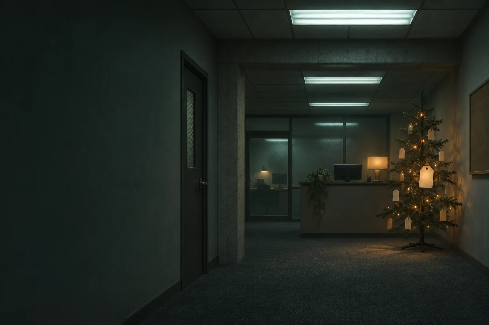
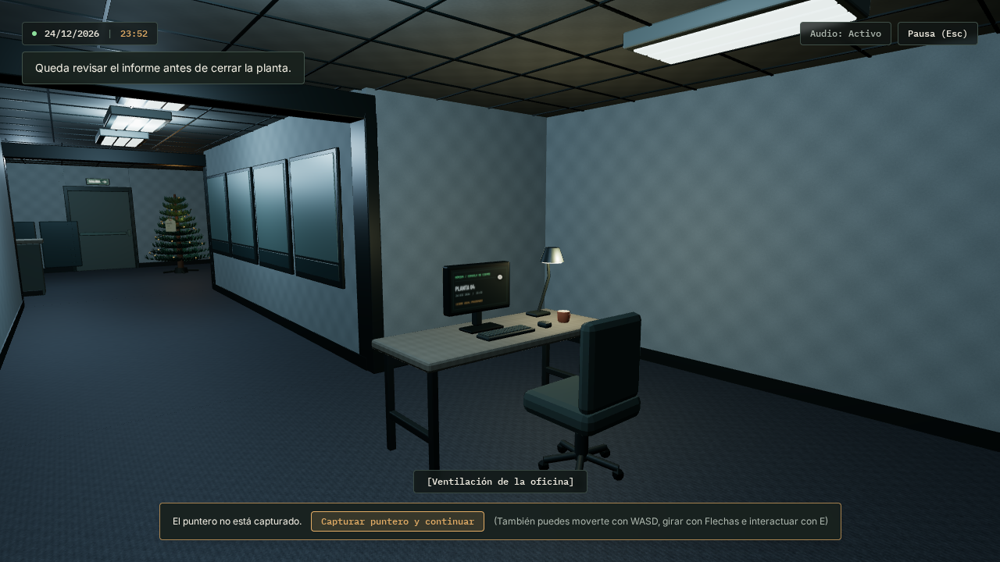

<p align="center">
  
</p>

<h1 align="center">El sistema dice que la oficina está vacía.</h1>

<p align="center">
  Un juego de terror narrativo 3D en español sobre una guardia de Nochebuena
  que el cierre anual intenta borrar.
</p>

<p align="center">
  <a href="#ejecutar-en-local">Puesta en marcha</a> ·
  <a href="#controles-y-accesibilidad">Controles</a> ·
  <a href="#desarrollo">Arquitectura</a> ·
  <a href="#documentación">Documentación</a>
</p>

> 24 de diciembre de 2026 · 23:52 · Planta 04
>
> El sistema dice que la oficina está vacía. Tú sigues dentro.



[El juego](#el-juego) · [Ejecutar en local](#ejecutar-en-local) · [Controles](#controles-y-accesibilidad) · [Desarrollo](#desarrollo) · [Verificación](#verificación) · [Despliegue](#despliegue) · [Documentación](#documentación)

## El juego

Es Nochebuena y sigues en la oficina. El cierre anual interpreta como vacías las guardias que terminan después de medianoche. Cuando un turno desaparece del registro, su puesto también desaparece del edificio.

Entre la consola corporativa, una bitácora y los adornos de un árbol de Navidad quedan las pruebas de que alguien estuvo allí. Tu trabajo es reconstruir esos registros antes de salir.

The Last Commit combina exploración en primera persona, lectura de evidencias y resolución de tres casos conectados. El menú ahora presenta la oficina en una escena 3D viva; al entrar, exploras un espacio cotidiano que cambia mientras reconstruyes los turnos borrados. Ventanales con lluvia, luz fría, árbol ámbar, efectos cinematográficos y audio espacial acompañan la investigación.

- **Un escritorio corporativo interactivo:** revisa correos con notas de voz y transcripciones, el Chat `#planta-04`, una Terminal Git ficticia y tres cámaras CCTV en directo.
- **Tres finales:** restaura y confirma los turnos, fuerza el cierre desde la terminal o insiste en la salida tras la desaparición.
- **Rejugabilidad y archivo:** selector de cuatro capítulos, galería de diez logros con ilustraciones y créditos cinematográficos. Los capítulos se desbloquean al avanzar.
- **Lectura a tu ritmo:** el reloj avanza por hitos de la historia; detenerte a leer no consume una cuenta atrás real.
- **Evidencias que puedes releer:** las pistas se conservan y una respuesta incorrecta ofrece ayuda sin borrarlas.
- **Continuidad entre sesiones:** progreso, logros, capítulos y ajustes se guardan en el navegador.

El juego incluye una introducción con A-07, escenas de investigación y una secuencia de cierre. La galería de logros y el selector de capítulos permiten volver a los hitos desbloqueados. Las capturas del [menú](evidence/title-live.png), el [escritorio](evidence/console-mail.png), las [cámaras](evidence/console-cctv.png) y los [logros](evidence/achievements.png) muestran partes de la experiencia y contienen spoilers.

La partida está diseñada para escritorio, con teclado y ratón. La duración prevista en el documento de diseño es de **12–15 minutos**; el primer suceso constituye una secuencia de **90–120 segundos**. Son objetivos de diseño, no tiempos medidos con jugadores.

<details>
<summary>Ver una captura del entorno inicial, sin revelar la resolución</summary>



</details>

## Ejecutar en local

### Requisitos

| Herramienta | Requisito                                                    |
| ----------- | ------------------------------------------------------------ |
| Node.js     | Node 24 LTS recomendado; `package.json` declara `>=22.12.0`  |
| pnpm        | `10.33.2`, versión fijada en `packageManager`                |
| Navegador   | De escritorio, con WebGL 2 y aceleración gráfica habilitada  |
| Python      | Python 3, necesario para verificar el inventario de recursos |

El entorno registrado en el [informe de entrega](docs/informe-entrega.md) utiliza Node `26.10.0` y pnpm `10.33.2`.

### Instalación

Con Node y pnpm disponibles:

```bash
git clone https://github.com/jeancdevx/the-last-commit.git
cd the-last-commit
pnpm install --frozen-lockfile
pnpm dev
```

Abre **http://localhost:4321** y selecciona **Jugar**. El clic de inicio permite activar el audio y solicitar la captura del puntero. El servidor indica otro puerto si el predeterminado está ocupado.

El proyecto se ejecuta sin claves de API, cuentas de usuario ni configuración de servicios externos. Los modelos, las texturas, las fuentes y el audio están incluidos en el repositorio.

El panel **http://localhost:4321/diagnostico/** permite revisar la disponibilidad de WebGL 2, la carga de modelos, el audio y el guardado local.

## Controles y accesibilidad

| Entrada               | Acción                                    |
| --------------------- | ----------------------------------------- |
| `W` / `S` o `↑` / `↓` | Avanzar / retroceder                      |
| `A` / `D`             | Desplazarse lateralmente                  |
| Ratón                 | Mirar alrededor con el puntero capturado  |
| `←` / `→`             | Girar la cámara como alternativa al ratón |
| `E`                   | Interactuar con el objeto señalado        |
| `Esc`                 | Cerrar la vista actual o abrir la pausa   |

Al abrir una pista, el panel o la pausa, se libera el puntero y se detiene el movimiento. Cuando hace falta volver a capturarlo, la interfaz ofrece una acción explícita.

En **Ajustes** puedes modificar volumen, silencio, sensibilidad de cámara, subtítulos de eventos sonoros y movimiento reducido. Las pistas tienen texto HTML y pueden releerse; las señales de estado incluyen texto además de color.

### Guardado

El juego conserva el progreso y los ajustes en `localStorage`, dentro del navegador y del origen desde el que se juega. Puedes continuar desde el menú; al reanudar, la posición del personaje puede restablecerse a un punto seguro.

Borrar los datos del sitio elimina la partida local. Otro navegador, perfil o dominio no comparte ese guardado. Si los datos están corruptos o tienen una versión incompatible, la aplicación ofrece iniciar de nuevo.

La consola, la bitácora y la confirmación del «commit» forman parte de la ficción del juego.

## Desarrollo

### Arquitectura

La aplicación se compila como un sitio estático. Astro genera las páginas y monta una isla de Preact con `client:only="preact"`. Dentro del navegador, Three.js controla la escena 3D y Web Audio reproduce el entorno sonoro.

| Capa              | Responsabilidad                                                        |
| ----------------- | ---------------------------------------------------------------------- |
| Astro             | Páginas, metadatos y rutas de recursos según la base de despliegue     |
| Preact            | Menús, pistas, consola, ajustes y acciones del jugador                 |
| `SceneEngine`     | Escena de título y juego, modelos GLB, cámara, raycasting, CCTV, iluminación, postprocesado y movimiento |
| `GameAudioEngine` | Ambiente, voces, efectos, fuentes espaciales y ajustes de sonido       |
| Estado narrativo  | Progresión, pistas, restauración de folios y desenlaces               |
| Progreso meta     | Capítulos, logros, finales descubiertos y correos leídos               |
| Persistencia      | Validación y almacenamiento local del progreso y los ajustes           |

El motor de escena es dueño del bucle de render; la interfaz recibe cambios relevantes sin actualizar su estado en cada fotograma. Los objetos, las colisiones, la iluminación y el audio derivan del mismo estado narrativo, independiente del reloj real.

**Tecnologías principales:** Astro, Preact, Three.js, TypeScript estricto, Tailwind CSS v4 y Web Audio API. Las versiones exactas están en [`package.json`](package.json) y [`pnpm-lock.yaml`](pnpm-lock.yaml).

### Mapa del repositorio

```text
src/
├── components/       # Interfaz del juego y panel de diagnóstico
├── helpers/          # Estado, escena, colisiones, audio, recursos y persistencia
├── hooks/            # Ajustes persistentes y mensajes temporales
├── layouts/          # Documento HTML, metadatos y estilos compartidos
├── pages/            # Entrada del juego y diagnóstico
├── styles/           # Tema visual y estilos globales
├── constants.ts      # Identificadores, claves de guardado y límites
├── types.ts          # Contratos de datos y estados
└── utils.ts          # Utilidades de validación y cálculo
public/assets/        # Recursos distribuidos con el juego
art-source/           # Másteres WAV incluidos para los efectos de audio
licenses/             # Avisos de licencia de las fuentes
tests/               # Pruebas unitarias y E2E
tooling/             # Verificador del kit y ejemplos de integración opcionales
docs/                # Diseño, procedencia e informe de comprobación
evidence/            # Capturas del recorrido automatizado
```

### Dónde modificar cada parte

| Cambio                                                          | Fuente de verdad                                                         |
| --------------------------------------------------------------- | ------------------------------------------------------------------------ |
| Guion, pistas, preguntas, respuestas y ayudas                   | [`public/assets/story.es.json`](public/assets/story.es.json)             |
| Modelos instanciados, escala, colisiones, luces e interacciones | [`public/assets/scene.json`](public/assets/scene.json)                   |
| Banco de sonido y configuración de clips                        | [`public/assets/audio/manifest.json`](public/assets/audio/manifest.json) |
| Reglas de progresión y restauración                             | [`src/helpers/state.helpers.ts`](src/helpers/state.helpers.ts)           |
| Capítulos, logros y finales                                     | [`src/helpers/achievements.helpers.ts`](src/helpers/achievements.helpers.ts) |
| Correo, chat y comandos ficticios de terminal                    | [`src/helpers/osData.helpers.ts`](src/helpers/osData.helpers.ts)        |
| Composición de oficina y objetos decorativos                     | [`src/helpers/setdressing.helpers.ts`](src/helpers/setdressing.helpers.ts) |
| Postprocesado y efectos de imagen                                | [`src/helpers/postprocess.helpers.ts`](src/helpers/postprocess.helpers.ts) |
| Tema y estilos de interfaz                                      | [`src/styles/global.css`](src/styles/global.css)                         |
| Flujo narrativo y criterios de aceptación                       | [`docs/diseno-e-integracion.md`](docs/diseno-e-integracion.md)           |

Las rutas de los manifiestos son relativas a `assets/`; los archivos del manifiesto de audio son relativos a `assets/audio/`. Para cargarlos desde código, utiliza las funciones de [`assets.helpers.ts`](src/helpers/assets.helpers.ts), que respetan la base de Astro.

Los manifiestos narrativos, el código y el documento de diseño contienen **spoilers**.

## Verificación

### Comandos disponibles

| Comando                             | Propósito                                                          |
| ----------------------------------- | ------------------------------------------------------------------ |
| `pnpm dev`                          | Iniciar el servidor de desarrollo                                  |
| `pnpm check`                        | Comprobar Astro y TypeScript                                       |
| `pnpm lint` / `pnpm lint:fix`       | Detectar problemas de código / aplicar correcciones automáticas    |
| `pnpm format:check` / `pnpm format` | Comprobar formato / formatear archivos                             |
| `pnpm test` / `pnpm test:watch`     | Ejecutar pruebas unitarias / trabajar en modo observación          |
| `pnpm test:e2e`                     | Ejecutar las pruebas de navegador sobre `dist/`                    |
| `pnpm verify:kit`                   | Validar referencias, contratos GLB, audio e inventario de recursos |
| `pnpm build`                        | Generar el sitio estático en `dist/`                               |
| `pnpm build:subpath`                | Generar el sitio con la base `/tlc/`                               |
| `pnpm preview`                      | Previsualizar una compilación local                                |

Para comprobar código, lógica y compilación:

```bash
pnpm format:check
pnpm lint
pnpm check
pnpm test
pnpm verify:kit
pnpm build
```

### Pruebas de navegador

Instala Chromium para Playwright una vez y genera una compilación con la base predeterminada antes de ejecutar las pruebas:

```bash
pnpm exec playwright install chromium
pnpm build
pnpm test:e2e
```

Playwright inicia el servidor de vista previa configurado sobre `dist/`. Si ya existe un servidor en el puerto `4321`, verifica que sirve la compilación que quieres probar. En Linux, la instalación de Chromium puede requerir dependencias del sistema.

Las pruebas E2E cubren carga de recursos y WebGL 2, movimiento, progresión de los folios, las aplicaciones del escritorio corporativo, persistencia, logros, capítulos, final y recuperación de errores. Generan capturas en `evidence/`.

El [informe de entrega](docs/informe-entrega.md) registra **18 pruebas unitarias** y **2 pruebas E2E** aprobadas en Chromium con SwiftShader. Ese entorno usa renderizado por software: la validación con ratón físico, la escucha espacial con auriculares y las mediciones de rendimiento con bloom y sombras en GPU permanecen documentadas como pendientes.

### Convenciones de trabajo

Husky ejecuta **lint-staged** antes de cada commit y **commitlint** valida los mensajes con Conventional Commits. Mantén los cambios agrupados por responsabilidad; usa, por ejemplo, `feat(story): …`, `fix(storage): …`, `test(e2e): …` o `docs(readme): …` según su propósito.

Si modificas recursos de `public/assets/`, actualiza su inventario y vuelve a verificarlo:

```bash
python3 tooling/verify-kit.py --write-inventory
pnpm verify:kit
```

Registra la procedencia y la licencia de cualquier recurso externo en [Créditos y fuentes](docs/creditos-y-fuentes.md), y conserva los avisos existentes.

## Despliegue

El resultado de `pnpm build` es el directorio **`dist/`**, que puede servirse desde un alojamiento estático. La aplicación funciona en el navegador y guarda la partida localmente.

Para publicar bajo un subdirectorio, configura `ASTRO_BASE` durante la compilación. En una shell POSIX:

```bash
ASTRO_BASE=/mi-juego/ pnpm build
```

Sirve después el contenido de `dist/` en `/mi-juego/`. El script `pnpm build:subpath` utiliza `/tlc/` como caso de comprobación. El diagnóstico quedará disponible bajo esa misma base: `/mi-juego/diagnostico/`.

Comprueba desde la URL final la carga de modelos, audio, fuentes y metadatos. Abrir `dist/index.html` directamente mediante `file://` no sustituye servir el sitio por HTTP.

## Solución de problemas

| Síntoma                                        | Qué revisar                                                                                                                                    |
| ---------------------------------------------- | ---------------------------------------------------------------------------------------------------------------------------------------------- |
| WebGL 2 no está disponible                     | Abre `/diagnostico/`, comprueba la aceleración gráfica y prueba un navegador de escritorio compatible. El juego presenta un aviso recuperable. |
| No se escucha audio                            | Interactúa con el botón de inicio y revisa el volumen, el silencio del juego y el silencio de la pestaña.                                      |
| El ratón no controla la cámara                 | Usa la acción explícita para capturar el puntero. Mientras tanto, las flechas permiten girar y avanzar.                                        |
| Faltan modelos, fuentes o sonido tras publicar | Revisa `ASTRO_BASE`, la ubicación de `dist/` y las peticiones fallidas en la pestaña de red del navegador.                                     |
| Playwright falla al iniciar                    | Instala Chromium, ejecuta `pnpm build` y comprueba qué servicio ocupa el puerto `4321`.                                                        |
| El inventario no coincide                      | Confirma que el cambio de recursos es intencional antes de regenerar los hashes.                                                               |

Para reportar un fallo, incluye navegador, sistema operativo, pasos de reproducción y errores de consola o de red. Indica si ocurre en una partida nueva o al continuar una guardada.

## Documentación

| Documento                                               | Contenido                                                                                          |
| ------------------------------------------------------- | -------------------------------------------------------------------------------------------------- |
| [Diseño e integración](docs/diseno-e-integracion.md)    | Flujo narrativo, nodos de modelos, dirección de arte y aceptación; contiene spoilers               |
| [Informe de entrega](docs/informe-entrega.md)           | Entorno probado, evidencias, resultados registrados y verificaciones pendientes; contiene spoilers |
| [Verificación del kit](docs/verificacion-del-kit.md)    | Comprobación de recursos y contratos del kit                                                       |
| [Créditos y fuentes](docs/creditos-y-fuentes.md)        | Procedencia de los recursos y avisos que deben conservarse                                         |
| [Herramientas para Gemini](docs/herramientas-gemini.md) | Configuraciones opcionales para herramientas de desarrollo                                         |

## Autoría y licencias

Proyecto de **[jeancdevx](https://github.com/jeancdevx)**.

El repositorio incluye los avisos **SIL Open Font License** de Barlow Condensed, IBM Plex Mono, Inter e Instrument Serif en [`licenses/`](licenses/). La procedencia del arte, los modelos, las texturas y el audio está recogida en [Créditos y fuentes](docs/creditos-y-fuentes.md).

Actualmente no se incluye una licencia general para el código y los recursos originales del proyecto. Las licencias de las fuentes corresponden a esos archivos concretos.
